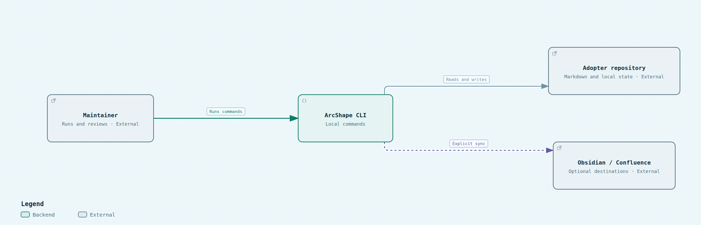

# 3. System scope and context

## Business context

The maintainer owns the repository and decides which documentation changes to accept. ArcShape runs locally in that repository: it creates the Markdown workspace, records evidence-session state, validates the documents, and renders the reader. A selected agent provider may use installed skills to inspect evidence and draft changes, but the provider is an external host rather than an ArcShape service. Readers consume the Markdown directly or use the generated static site. Optional sync commands publish to destinations chosen by the maintainer.

ArcShape packages canonical skills separately from the CLI and installs them into the provider-specific discovery paths. The CLI detects local evidence, lets the maintainer select providers, previews file operations, and tracks managed-file hashes. It does not launch agents or contact marketplaces. Obsidian synchronization is local; Confluence publication is directed and explicit. In both cases, external writes are bounded by a selected destination and conflict detection.

<!-- pdac:cite id="FR-ASSISTED-WORKFLOWS" digest="sha256:ac09dcb4dd5f8d437006a51f654c3f1b3d218dc223ca1ebb0a67311bdfe6b0ed" -->
<!-- pdac:cite id="FR-AGENT-CAPABILITY-DISTRIBUTION" digest="sha256:df30499fca2ce723bbccc3a1a8d590a5fc69b2f9532472b01c3accba8327dc04" -->
<!-- pdac:cite id="FR-ONBOARD-REPOSITORY" digest="sha256:ad28a7a6a80b8c334af9daa92a36c929b812c654611bebe10aac9b487072ef98" -->
<!-- pdac:cite id="FR-EXTERNAL-DOCS-INTEGRATIONS" digest="sha256:f929081da500e66834eb9a2e1dd6c4ef16dd6a066168d275b49cee6989c37616" -->

## Technical context

<!-- arcshape-diagram-source: ./diagrams/context.archify.json -->

The boundary is intentionally small: ArcShape is the local CLI, while the repository and publication destinations remain outside it. Agent providers are deliberately absent from this context view because they consume installed Markdown skills inside the adopter repository rather than calling an ArcShape service; that interaction is shown in the container view. `arcshape init` creates scaffold files and selected skill instructions; it does not contact an ArcShape service or launch an agent. External publication is never implicit in initialization.

<!-- pdac:cite id="FR-READER-VIEW" digest="sha256:ff3d03ebe93668cb0392a672fe63b9925404fab9dc2fb7891931f1f5d2ea799d" -->
