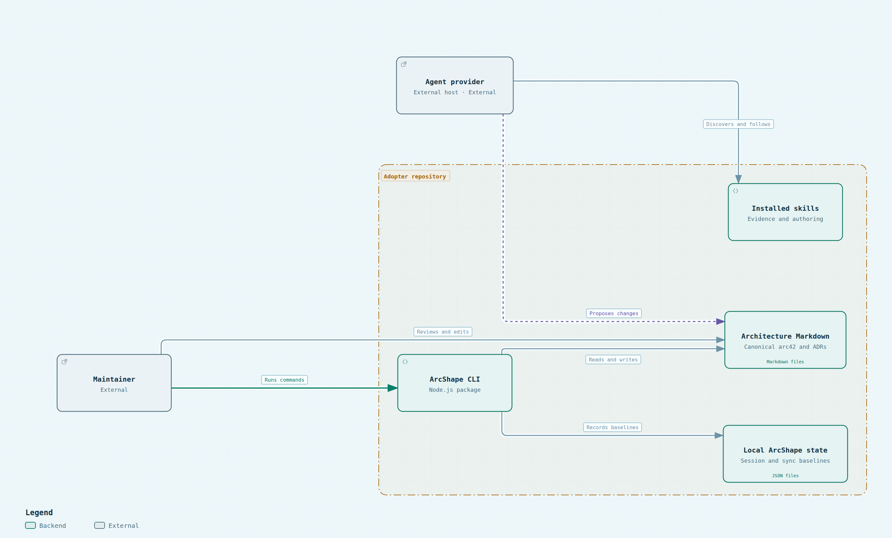

# 5. Building block view

## Level 1: system

ArcShape is a private npm workspace whose distributable CLI runs inside an adopter's repository. It combines deterministic repository operations with an optional package of provider-neutral skills and a Markdown reader. The workspace root owns development dependencies and repository automation. ArcShape has no server or database.

## Level 2: building blocks

| Building block | Responsibility | Evidence |
| --- | --- | --- |
| CLI entry point | Parses commands and routes setup, evidence sessions, validation, sync, and site builds. | [`packages/cli/src/bin/arcshape.mjs`](../../../packages/cli/src/bin/arcshape.mjs) |
| CLI modules | Implement repository setup, capability management, sessions, validation, and documentation sync. | [`packages/cli/src/bin/`](../../../packages/cli/src/bin/) |
| Architecture templates | Supplies the README and twelve arc42 Markdown sections. | [`packages/cli/assets/architecture/`](../../../packages/cli/assets/architecture/) |
| Capability package | Supplies provider-neutral skills, provider discovery metadata, and managed-file hashes. | [`packages/cli/assets/capabilities/`](../../../packages/cli/assets/capabilities/) |
| Site renderer | Validates Markdown, renders Mermaid and native sources, and publishes either a single-file snapshot or an interactive directory. | [`packages/cli/src/arc42-site/`](../../../packages/cli/src/arc42-site/) |
| Native diagram adapter | Validates bounded JSON, invokes the pinned renderer, exports static SVG and bounded PNG, and isolates the browser viewer. | [`native-diagrams.mjs`](../../../packages/cli/src/arc42-site/native-diagrams.mjs), [`native-viewer.mjs`](../../../packages/cli/src/arc42-site/native-viewer.mjs) |
| Product and publication surfaces | Remain adjacent repository artifacts: product intent, public site, engineering portal, and delivery workflows. | [`docs/product/model/`](../../product/model/), [`src/`](../../../src/), [`.github/workflows/`](../../../.github/workflows/) |

<!-- pdac:cite id="FR-ASSISTED-WORKFLOWS" digest="sha256:ac09dcb4dd5f8d437006a51f654c3f1b3d218dc223ca1ebb0a67311bdfe6b0ed" -->
<!-- pdac:cite id="FR-AGENT-CAPABILITY-DISTRIBUTION" digest="sha256:df30499fca2ce723bbccc3a1a8d590a5fc69b2f9532472b01c3accba8327dc04" -->

<!-- pdac:cite id="FR-INTERACTIVE-DIAGRAMS" digest="sha256:c3b23d66ee088a457d58ae8bd22645d99e0f0618ff30fa242bd7ddf700a1f7c7" -->

## C4 container view

The CLI installs canonical Markdown and optional agent skills into the selected repository. Agent providers remain external hosts; ArcShape does not host an AI runtime. Local state records evidence sessions, sync baselines, and capability ownership. The diagram separates those responsibilities so the write paths are visible without implying that an agent provider calls an ArcShape server.

<!-- arcshape-diagram-source: ./diagrams/containers.archify.json -->

The reader build owns native-bundle resolution and the compatibility path for existing Mermaid sources. Its parser worker isolates Mermaid's DOM setup from the reader's sanitizer; the deterministic layout adapter passes validated data into the existing native renderer. These build-time modules do not add a runtime service.
<!-- pdac:cite id="FR-CLI-COMMANDS" digest="sha256:8ef95cb49549967275a46362840b5e8b272696b14cabb7c80a321e5b7719ffff" -->
