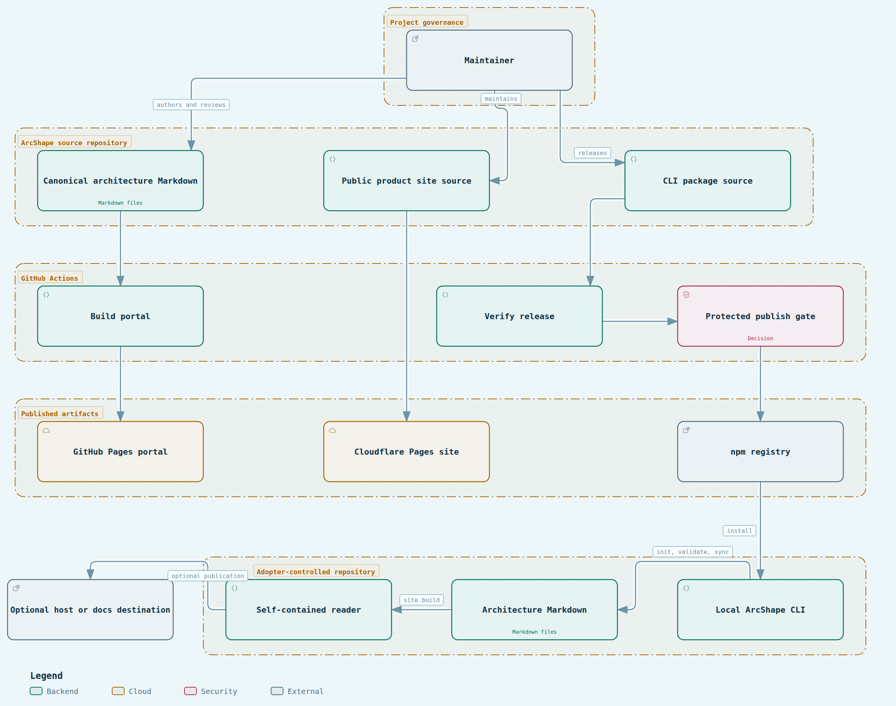

# 7. Deployment view

## Infrastructure overview

ArcShape runs as a local Node.js process in the adopter's repository. The source repository publishes the `@arcshape/cli` package through a reviewed, environment-gated release workflow; release mechanics and recovery belong in [`docs/releasing.md`](../../releasing.md), not in this topology view.

Session state is stored locally in `.arcshape/sessions/<session-id>/session.json`. It is not sent to an ArcShape service.

Obsidian sync writes Markdown into the selected local vault and stores its manifest beside those notes. Confluence sync stores page mappings and content hashes in `.arcshape/confluence-sync/`; multi-page mode publishes an index and the twelve arc42 sections plus any explicitly selected Markdown beneath the chosen Confluence Cloud parent page only when run without `--dry-run`.

## Deployment mapping

| Environment | What lives there | Boundary |
| --- | --- | --- |
| ArcShape source repository | CLI source, templates, canonical product and architecture Markdown | Maintained by the project; CI reads it and produces projections. |
| GitHub Actions | Engineering portal build, release verification, and assurance jobs | Ephemeral execution; the protected publish environment gates npm publication. |
| GitHub Pages | Engineering portal and source-revision-stamped snapshots | Public static artifact generated from the source repository. |
| Cloudflare Pages | Public product site static output | Separate product-site publication path. |
| npm registry | Versioned `@arcshape/cli` package | Distribution only; it does not store adopter documentation. |
| Adopter repository | Local CLI process, canonical architecture Markdown, and `.arcshape/` state | The primary runtime boundary. |
| Selected destination | Obsidian notes or Confluence pages | Written only by an explicit sync command; conflicts stop overwrites. |

## Published artifacts and adopter deployment

The source repository produces three independent kinds of output: the public product site, the engineering portal, and the npm package. Adopters install the package into their own repository, run the CLI locally, and choose whether to publish the generated reader. ArcShape does not operate the adopter's runtime, reader host, Obsidian vault, or Confluence space.

The companion [Archify publication-boundaries diagram](../../../src/engineering-portal/public/diagrams/publication-boundaries.html) is a standalone static artifact generated from the reviewed candidate at `.archify/arcshape-publications/arcshape-publication-boundaries.json`.

<!-- arcshape-diagram-source: ./diagrams/deployment.archify.json -->
