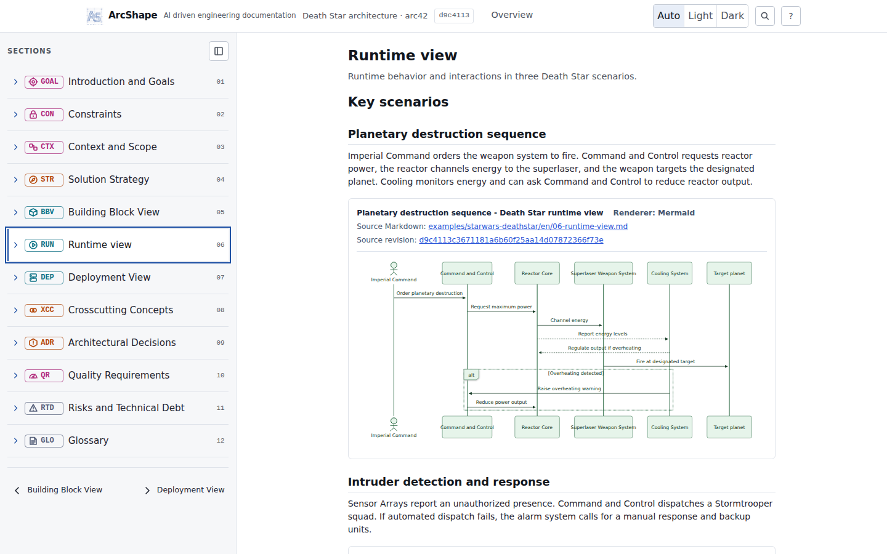
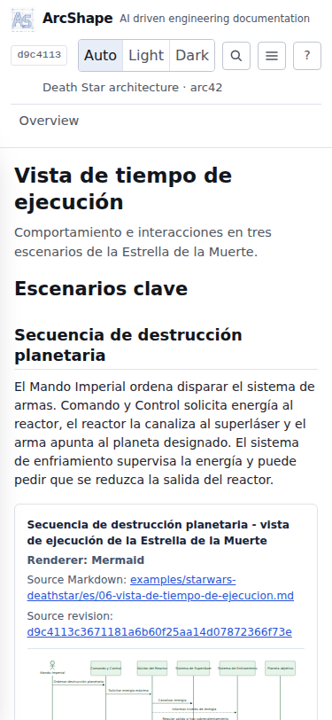
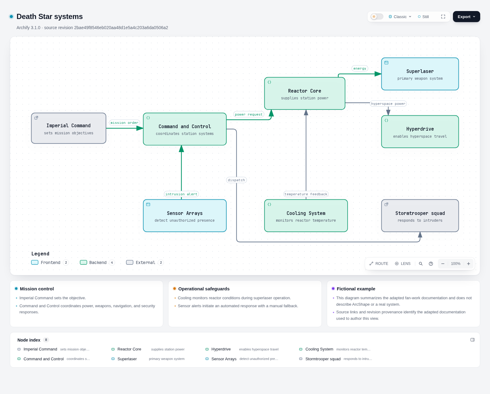

# Issue #80 review evidence

This bundle records the locally built Death Star architecture example and the automated browser evidence for [PR #81](https://github.com/juangcarmona/arcshape/pull/81).

## Revisions and license

- Source example: [`juangcarmona/starwars-deathstar-arc42-documentation`](https://github.com/juangcarmona/starwars-deathstar-arc42-documentation/tree/6a5576bda72de08a217ccdf94461c5eaeea9f8a5), revision `6a5576bda72de08a217ccdf94461c5eaeea9f8a5`.
- ArcShape implementation revision used to generate the local screenshots: `edf7716a9283aeda498a8985714933f84cb9bd90`.
- GitHub Actions tested PR head: `ada369a1d55f51e991cc905ae9a0369ffbc60181`; its synthetic merge revision was `817eedbee171c7e90460e76e14d07bdd1876bb7e`.
- The adapted source material is licensed CC BY-NC 4.0. Attribution, a link to the license, and a modification notice are retained in both locale entry points. The example is fictional fan work and is not affiliated with or endorsed by Lucasfilm Ltd. or Disney. The non-commercial restriction must be considered before any later publication.

The adaptation keeps the overview and all twelve arc42 sections in English and Spanish, along with the referenced artwork. It corrects the runtime-sequence inconsistencies identified in the source and the Spanish overview's English image alternative text. No narrative section was intentionally dropped. The original content was adapted to ArcShape's README, numbered-file, and frontmatter contract.

## Acceptance evidence map

| Issue #80 acceptance criterion                                                                                          | Evidence                                                                                                                                          |
| ----------------------------------------------------------------------------------------------------------------------- | ------------------------------------------------------------------------------------------------------------------------------------------------- |
| EN/ES example, all twelve sections, attribution, license, modification note, and disclaimer                             | `examples/starwars-deathstar/en/README.md`, `examples/starwars-deathstar/es/README.md`; reader builds and locale assertions in the E2E run below. |
| Reader contract, corrected scenario/sequence content, localized alternative text, and self-contained root/subpath links | The two locale source folders; Playwright root and `/arcshape/` coverage in the retained report and traces.                                       |
| Accessible Mermaid and Archify with renderer/source provenance                                                          | Mermaid source and built reader assertions; `examples/starwars-deathstar/diagrams/` manifest and HTML; Archify screenshot and E2E checks.         |
| Desktop and narrow examples plus review evidence                                                                        | The three screenshots in this folder, dimensions and observations below, and the linked Actions report/traces.                                    |
| Human judgement on clarity, visual appeal, Spanish adaptation, and test adequacy                                        | Still open for the repository maintainer; screenshots and automation supply evidence but do not decide these criteria.                            |
| Isolated example without a public route or Cloudflare publication                                                       | Example remains under `examples/`; no public or engineering route was added. Publication was not tested.                                          |

## Captures

### English reader — desktop

- Browser viewport: **1440 × 900**.
- Route: English example at the root base path.
- Observation: the reader presents the architecture navigation and rendered Mermaid sequence diagrams in the normal page flow.

### Spanish reader — narrow viewport

- Browser viewport and capture: **375 × 812**.
- Route: Spanish example at the `/arcshape/` base path.
- Observation: the localized reader remains readable at the narrow viewport; the Playwright scenario also checks for horizontal overflow and validates the generated links.

### Archify — desktop

- Browser viewport: **1600 × 1100**; the screenshot is full-page at **1600 × 1285**.
- Route: the bundled Archify static HTML example.
- Observation: renderer identity, source revision, and the architecture component diagram are visible. The E2E scenario exercises keyboard focus and checks the root and `/arcshape/` paths for external runtime fetches.

## Automated browser evidence

The [Assurance workflow run](https://github.com/juangcarmona/arcshape/actions/runs/39450320164) tested PR head `ada369a1d55f51e991cc905ae9a0369ffbc60181`. Its `arcshape-e2e-817eedbee171c7e90460e76e14d07bdd1876bb7e` artifact contains the Playwright HTML report, test results, and traces for both showcase scenarios. The workflow reports **7 E2E scenarios passed** and **passive DAST passed**; mutation analysis was skipped because it is scheduled/manual.

The E2E scenarios build both locales at root and `/arcshape/`, assert all twelve sections, check Mermaid and Archify identity/accessibility/provenance, exercise keyboard interaction, and check narrow layout and offline behavior. The local screenshots above are from the same branch revision. The Archify source, generated document, and candidate manifest are retained alongside the example; E2E verifies the pinned renderer/source revisions and generated-artifact hashes.

The current-head CI quality matrix, Product model, secret scan, dependency audit, CodeQL analysis, and SBOM/license policy are reported in [CI run 39450320134](https://github.com/juangcarmona/arcshape/actions/runs/39450320134), [Security run 39450320166](https://github.com/juangcarmona/arcshape/actions/runs/39450320166), and [CodeQL run 39450320244](https://github.com/juangcarmona/arcshape/actions/runs/39450320244). E2E and passive DAST are advisory contexts under the active ruleset. The separate `Repository conventions` context failed because an earlier commit in the PR history, `f2a6fe433871936c24df208f7d889202bdcaed16`, lacks the required `Refs #80` footer; a later commit adds the implement-skill commitlint preflight, but does not rewrite that historical commit.

## Evidence limits and open review

These captures and checks demonstrate a local static build and its browser behavior. They do not demonstrate a public-site route, Cloudflare Pages configuration, production deployment, or publication approval. They are not a full screen-reader audit and do not establish that every architecture document will be clear or visually compelling. A human reviewer still needs to judge the adaptation's clarity and visual appeal, Spanish quality, test adequacy, security exceptions, and Archify's accessibility limitations.

The Archify contract was initially pinned to PR #79 at `eb4974b8db8b158fa907ceff15c247d198d07cff`. Issue #78 / PR #79 remains unmerged; this example must be revalidated against the merged #78 contract before integration. No merge or publication is implied by this evidence bundle.
