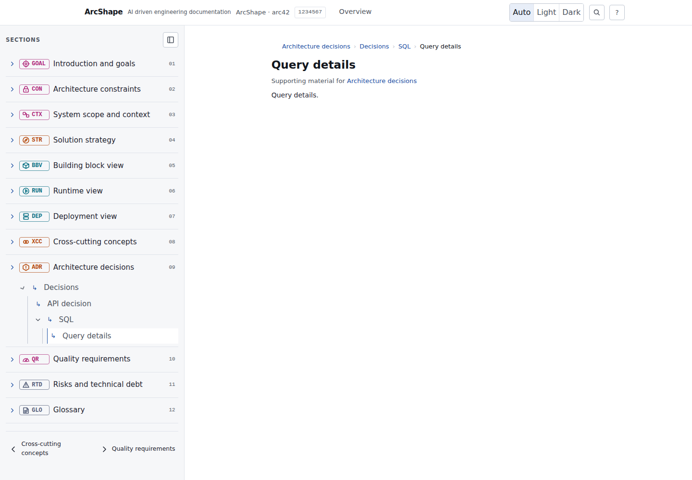

# Issue #97 runtime evidence

This evidence bundle records the generated ArcShape reader after implementing hierarchical supporting-document navigation for [issue #97](https://github.com/juangcarmona/arcshape/issues/97).

## Capture

- Browser viewport: **1440 × 1000**.
- Route: `#/section/09/decisions/sql/query`.
- Fixture structure: `decisions/README.md`, `decisions/api.md`, `decisions/sql/README.md`, and `decisions/sql/query.md`.
- Observation: the current route expands `Decisions` and `SQL`, displays leaves before nested folders, marks `Query details` as current, and renders the `Architecture decisions > Decisions > SQL > Query details` breadcrumb trail.

## Automated browser evidence

`GITHUB_ACTIONS=true npx vitest run tests/reader-accessibility.test.mjs tests/section-directories.test.mjs` passed **2 files / 16 tests**. The browser scenario opens the nested route, checks ancestor expansion and current-link metadata, follows folder README breadcrumbs, and toggles the nested folder with a pointer click and keyboard Enter.

The complete local deterministic run `GITHUB_ACTIONS=true npm run verify` passed **26 files / 128 tests**, plus format, lint, typecheck, and build.
