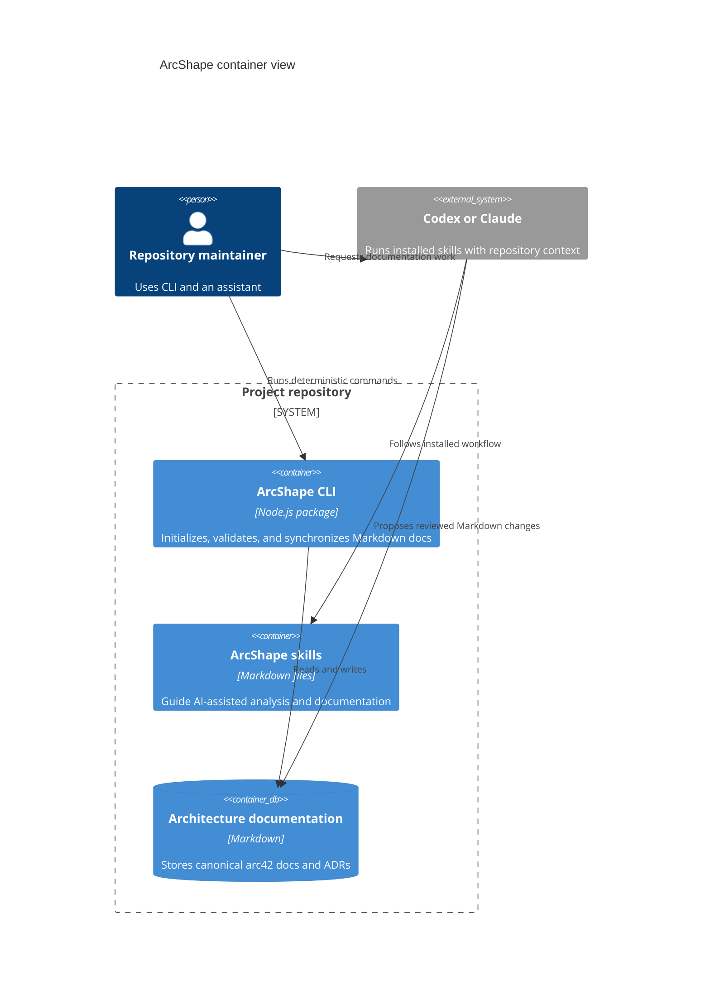

# Container view example

Evidence: `packages/cli/package.json` maps the `arcshape` command to `src/bin/arcshape.mjs`. `packages/cli/src/bin/arcshape.mjs` dispatches deterministic commands to the CLI modules under `packages/cli/src/bin/`. `packages/cli/assets/capabilities/skills/` contains provider-neutral skills installed into supported agent discovery locations. `README.md` describes the maintainer invoking an assistant skill separately from a deterministic CLI command.

The assistant runtime is external; ArcShape does not host an AI service.

