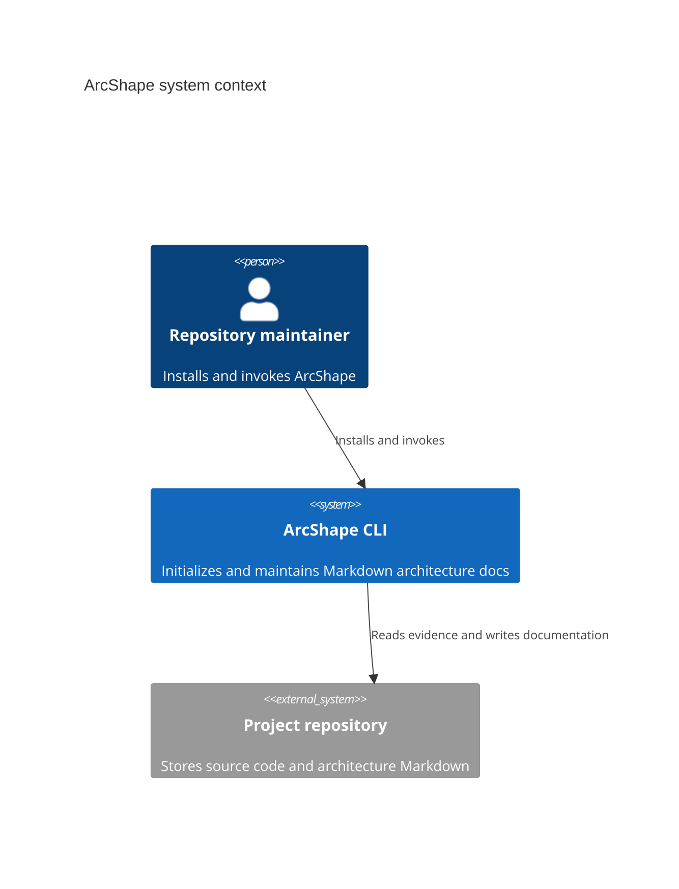

# System context example

Evidence: `package.json` exposes the `arcshape` executable as `bin/arcshape.mjs`. `README.md` documents installing the package in a project repository and invoking `npx arcshape init`. The CLI reads and writes files in the selected repository, including `docs/architecture/` and `.arcshape/sessions/`.

External systems are omitted because these interactions require no external service.

